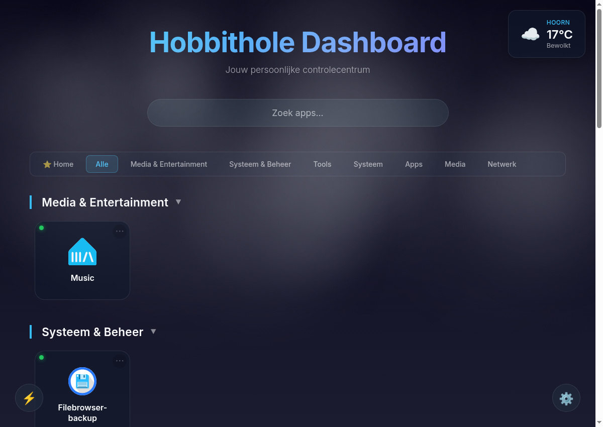
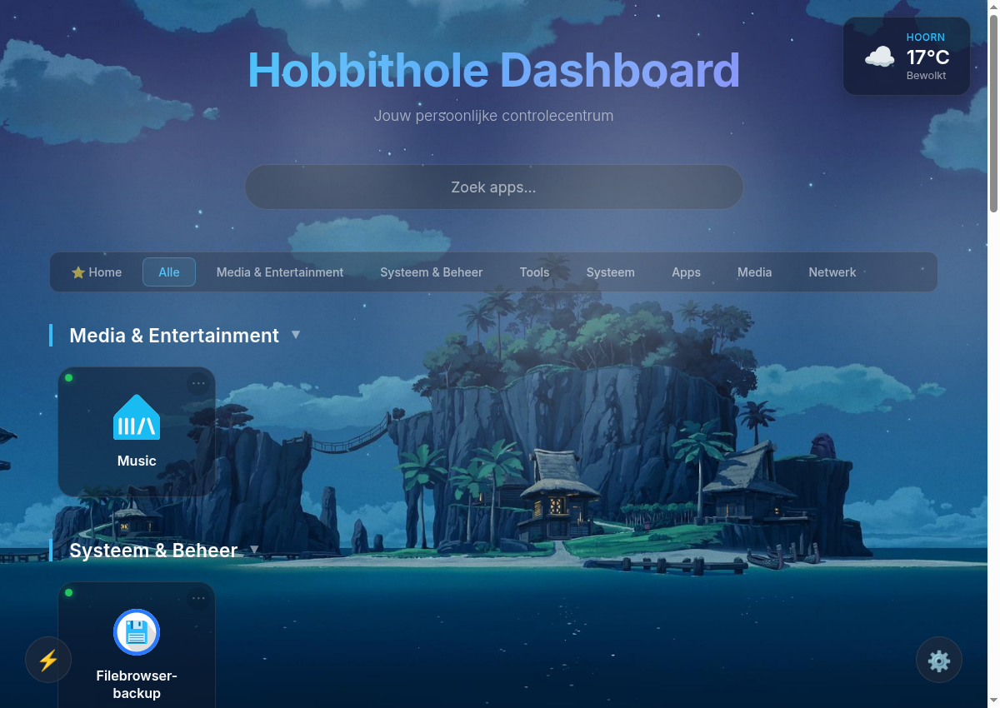

# Hobbithole Dashboard - Zero-Config Homelab Dashboard


A blazing fast, responsive, self‑configuring dashboard for your homelab. Smart Docker auto‑detection, a cinematic weather widget, and **cross‑device settings sync** via a tiny config API.

> **v1.9.10** — **Cross-device wallpapers** (static / dynamic 5-slot / live video) stored as files on the config-api; **smarter container Start/Stop/Restart** (works for stopped containers, host-network apps, and domain tiles); live weather radar polish; release popup hardened (shows at most once).
>
> Previously in **v1.9.9**: Weerenradar + global RainViewer, home weather-radar widget, canvas mode on server. **v1.9.5**: media showcase. **v1.9.4**: VM/Service control. **v1.9.3**: Universal USB Eject.
>
> **Upgrade tip:** always pull **both** images (`hobbithole-dashboard` **and** `hobbithole-config-api`) to the same version. The API is required for sync, wallpapers, themes and widgets.

## USB Eject Configuration

The dashboard supports two methods for safely unmounting external drives:

1.  **`SIGNAL` Mode (Default)**: The container writes a signal file. A simple script on your host (provided in the GitHub repo) monitors these signals and performs the actual `umount`. This is the safest method as it doesn't require extra Docker permissions.
2.  **`NATIVE` Mode**: The dashboard performs the `umount` command directly from within the container.
    *   **Requirement**: You must add `privileged: true` to the `config-api` service in your Docker Compose.
    *   **Environment Variable**: Set `USB_EJECT_METHOD=native` on the `config-api` service.

## Install via Docker Compose

```yaml
services:
  dashboard:
    image: piggyoriginal/hobbithole-dashboard:latest
    container_name: hobbithole-dashboard
    restart: unless-stopped
    ports:
      - "8086:80"
    volumes:
      # Required for automatic Docker container detection
      - /var/run/docker.sock:/var/run/docker.sock:ro
    networks:
      - dashboard_net
    depends_on:
      - config-api

  config-api:
    image: piggyoriginal/hobbithole-config-api:latest
    container_name: hobbithole-config-api
    restart: unless-stopped
    volumes:
      # Persistent settings (cross-device sync)
      - ./data:/app/data
      # Optional: enables the Container Manager / Portainer "local" widget
      - /var/run/docker.sock:/var/run/docker.sock:ro
    networks:
      - dashboard_net

networks:
  dashboard_net:
    driver: bridge
```

**Before `docker compose up -d`, create the data folder:**

```
mkdir -p data && chmod 777 data
```

## Pull the images directly

```
docker pull piggyoriginal/hobbithole-dashboard
docker pull piggyoriginal/hobbithole-config-api
```

## Features

- **Cross‑device wallpapers** (v1.9.10) — static image, dynamic time-of-day slots (5), and live video; files live under config-api `data/wallpapers/` (not bloated into `config.json`)
- **Container quick actions** (improved v1.9.10) — Start / Stop / Restart on tiles; matches by port **or** container/compose name (stopped containers, `network_mode: host`, domain/NPM tiles)
- **Live weather radar** (v1.9.9+) — Weerenradar (Europe) + RainViewer global; home widget + expanded panel, layer chips, zoom
- **Canvas mode** (GA) — free-place home widgets; preference synced via config-api
- **Theme engine** (v1.9.0+) — curated experiences (Classic, Glass Ocean, Midnight Neon, Nordic Frost)
- **USB & External Storage Management** (v1.9.2) — safely unmount USB / external SSDs (SIGNAL or NATIVE eject)
- **Live p95 Resource Metrics** (v1.9.2) — on-demand CPU/RAM benchmark for containers
- **Proxmox / VM control** (v1.9.4) — status + start/stop/restart for VMs and LXCs
- **First‑Run Wizard** (zero setup)
- **Smart Docker Detection** — auto‑detects containers via image name + dashboard‑icons CDN (1000+ apps)
- **Dynamic IP Auto‑Detection**
- **Customizable look** — accent color, card transparency, wallpapers, animated weather backdrop
- **Responsive UI** (desktop/mobile aware)
- **Drag & Drop** layout
- **Cross‑device settings sync** via lightweight config API
- **Cinematic Weather Widget**
  - Expandable hourly (3‑hour blocks) + 7‑day outlook
  - Search location by city name (no coordinates needed)
  - Animated backdrop: rain, snow, sun (toggle in settings)
  - Buienradar / Open‑Meteo hybrid (free; no API key for Open‑Meteo)
- **Live App Widgets** — server‑side fetched, cached per type (SABnzbd, Pi‑hole, Sonarr/Radarr, Jellyfin, Plex, …)
- **Command Palette** (`Cmd/Ctrl+K`) — fuzzy launcher for apps + actions
- **⋯ Tile menu** — pin / edit / delete
- **Live status dots** — green/red ping on every tile
- **Pinned favorites strip**
- **Fuzzy Search** across tiles
- **Backup & Restore** settings as JSON
- **Screensaver Mode** — fullscreen clock when idle
- **Multi‑language** (NL / EN / DE / FR / ES)

## Screenshots

| Main Dashboard | Weather Widget | Dynamic Wallpaper |
| :---: | :---: | :---: |
|  |  |  |

## Perfect for

NAS systems, homelabs, Docker users, and anyone who wants a clean, self‑configuring dashboard without hassle.

Made using LokaiOS — the AI‑native operating system.
