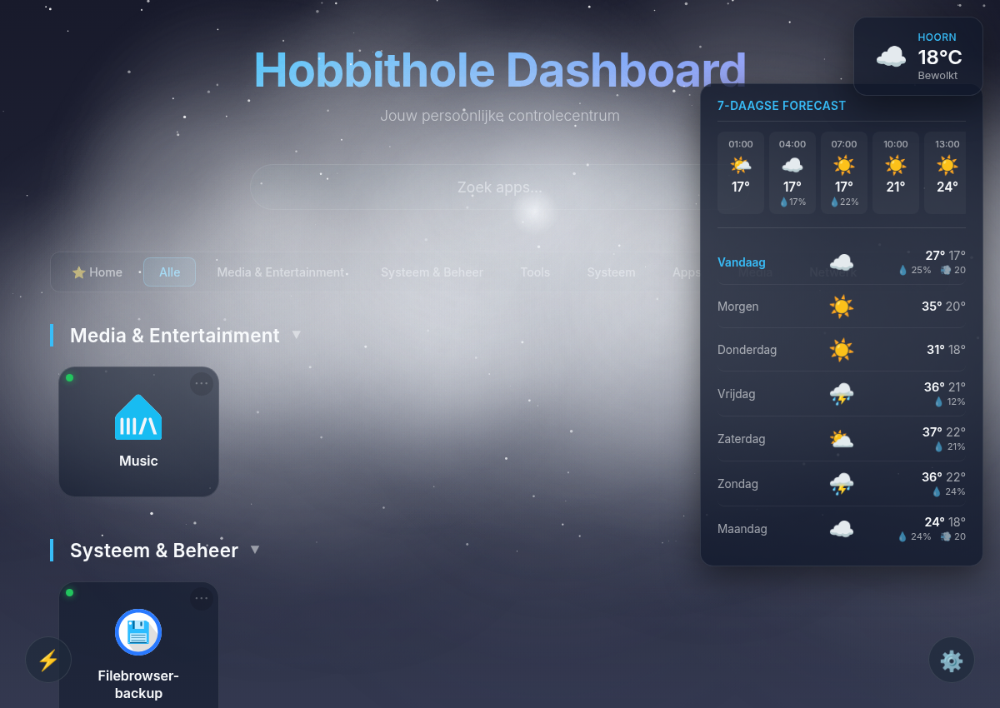

# Hobbithole Dashboard - Zero-Config Homelab Dashboard


A blazing fast, responsive, self‑configuring dashboard for your homelab. Smart Docker auto‑detection, a cinematic weather widget, and **cross‑device settings sync** via a tiny config API.

> **v1.10.0** — **Optional authentication** (off by default) so you can put the dashboard behind a reverse proxy safely, plus a pack of **Docker scan / tile / URL** fixes. Details below.
>
> Previously in **v1.9.10**: cross-device wallpapers + smarter container Start/Stop/Restart. **v1.9.9**: weather radar. **v1.9.5**: media showcase. **v1.9.4**: VM/Service control. **v1.9.3**: Universal USB Eject.
>
> **Upgrade tip:** always pull **both** images (`hobbithole-dashboard` **and** `hobbithole-config-api`) to the **same version**. The API is required for sync, wallpapers, themes, widgets, and auth.

## What's new in v1.10.0

### Added

- **Optional authentication** (product feature, **off by default** — existing installs unchanged)
  - **UI:** Settings → Security → “Secure this dashboard” (zero-config; `SESSION_SECRET` auto under `data/auth/`)
  - **Compose lock:** `AUTH_ENABLED=true|false` on config-api locks the toggle
  - First visit creates the admin (email + password; password Show/Hide on login)
  - Unauthenticated clients get **401** on `/api/*` (except `/api/health` and `/api/auth/*`)
  - Multi-user per install via admin API (`POST /api/auth/users`); OIDC/passkeys later
- **Docker actions via config-api** — containers list/start/stop/restart no longer go raw browser → nginx → Docker socket; raw `/docker/` is closed so auth can protect those actions
- **Release popup** — one-time note about optional login + safer remote access via reverse proxy

### Fixed

- **Login loop on LAN HTTP** — session cookie is no longer forced `Secure` only because `AUTH_PUBLIC_URL` is https; `Secure` follows the request (`X-Forwarded-Proto` / TLS). Override with `AUTH_COOKIE_SECURE` if needed
- **Empty dashboard / no login UI** — JS crash in the auth overlay; 401 on config now opens login instead of a blank offline shell
- **Docker scan wrong host** — no longer reuses Synology `localStorage` NAS IP for every scanned tile; uses the dashboard host (or an explicit field)
- **Docker scan wrong port / scheme** — prefers the published **HTTPS** port when available (e.g. webtop `https://host:3021` instead of a random `http://` twin port that looked “broken”)
- **Docker scan on a domain host** — warns to fill in the LAN IP instead of silently building reverse-proxy tiles
- **Delete tile left orphan widgets + API keys** — widget config is removed with the tile; existing orphans are pruned at startup
- **Deleted tile came back after refresh** — category changes no longer silently skip when config-api was briefly unavailable
- **App URL field** — bare IPs / typing `//` work again (`type=text` + auto-`http://` when no scheme)
- **`/` keyboard shortcut** — no longer steals `/` inside inputs (you can type `http://` in Add/Edit App)

### Security

- Do not expose port **8086** to the internet without auth (or reverse-proxy auth)
- Auth status is never treated as “off” on a failed status fetch (avoids a silent empty 401 UI)

## Optional authentication (how to enable)

Default remains **open / zero-config**. When you want login (e.g. before nginx / NPM / Cloudflare):

1. **UI (recommended):** Settings → Security → enable “Secure this dashboard”. First browser creates the admin.
2. **Compose lock (ops):** set `AUTH_ENABLED=true` on **config-api** (optional `SESSION_SECRET`).
3. **Do not** put port `8086` on the public internet without auth (or reverse-proxy auth).

## USB Eject Configuration

The dashboard supports two methods for safely unmounting external drives:

1.  **`SIGNAL` Mode (Default)**: The container writes a signal file. A simple script on your host (provided in the GitHub repo) monitors these signals and performs the actual `umount`. This is the safest method as it doesn't require extra Docker permissions.
2.  **`NATIVE` Mode**: The dashboard performs the `umount` command directly from within the container.
    *   **Requirement**: You must add `privileged: true` to the `config-api` service in your Docker Compose.
    *   **Environment Variable**: Set `USB_EJECT_METHOD=native` on the `config-api` service.

## Install via Docker Compose

```yaml
services:
  dashboard:
    image: piggyoriginal/hobbithole-dashboard:latest
    container_name: hobbithole-dashboard
    restart: unless-stopped
    ports:
      - "8086:80"
    volumes:
      # Required for automatic Docker container detection
      - /var/run/docker.sock:/var/run/docker.sock:ro
    networks:
      - dashboard_net
    depends_on:
      - config-api

  config-api:
    image: piggyoriginal/hobbithole-config-api:latest
    container_name: hobbithole-config-api
    restart: unless-stopped
    # Optional — lock auth on (or set false to force off). Omit = UI can toggle.
    # environment:
    #   - AUTH_ENABLED=true
    #   - SESSION_SECRET=change-me-long-random   # optional; auto file if omitted when auth on
    volumes:
      # Persistent settings (cross-device sync) + auth data under data/auth/
      - ./data:/app/data
      # Optional: enables the Container Manager / Portainer "local" widget + container actions
      - /var/run/docker.sock:/var/run/docker.sock:ro
    networks:
      - dashboard_net

networks:
  dashboard_net:
    driver: bridge
```

**Before `docker compose up -d`, create the data folder:**

```
mkdir -p data && chmod 777 data
```

## Pull the images directly

```
docker pull piggyoriginal/hobbithole-dashboard
docker pull piggyoriginal/hobbithole-config-api
```

## Features

- **Optional authentication** (v1.10.0) — off by default; UI or compose; API lock + login overlay
- **Safer Docker control plane** (v1.10.0) — start/stop/restart via config-api; smarter scan (host/HTTPS/orphan widgets)
- **Cross‑device wallpapers** (v1.9.10) — static image, dynamic time-of-day slots (5), and live video; files under config-api `data/wallpapers/`
- **Container quick actions** (improved v1.9.10) — Start / Stop / Restart on tiles; matches by port **or** container/compose name
- **Live weather radar** (v1.9.9+) — Weerenradar (Europe) + RainViewer global; home widget + expanded panel
- **Canvas mode** (GA) — free-place home widgets; preference synced via config-api
- **Theme engine** (v1.9.0+) — curated experiences (Classic, Glass Ocean, Midnight Neon, Nordic Frost)
- **USB & External Storage Management** (v1.9.2) — safely unmount USB / external SSDs (SIGNAL or NATIVE eject)
- **Live p95 Resource Metrics** (v1.9.2) — on-demand CPU/RAM benchmark for containers
- **Proxmox / VM control** (v1.9.4) — status + start/stop/restart for VMs and LXCs
- **First‑Run Wizard** (zero setup)
- **Smart Docker Detection** — auto‑detects containers via image name + dashboard‑icons CDN (1000+ apps)
- **Dynamic IP Auto‑Detection**
- **Customizable look** — accent color, card transparency, wallpapers, animated weather backdrop
- **Responsive UI** (desktop/mobile aware)
- **Drag & Drop** layout
- **Cross‑device settings sync** via lightweight config API
- **Cinematic Weather Widget**
  - Expandable hourly (3‑hour blocks) + 7‑day outlook
  - Search location by city name (no coordinates needed)
  - Animated backdrop: rain, snow, sun (toggle in settings)
  - Buienradar / Open‑Meteo hybrid (free; no API key for Open‑Meteo)
- **Live App Widgets** — server‑side fetched, cached per type (SABnzbd, Pi‑hole, Sonarr/Radarr, Jellyfin, Plex, …)
- **Command Palette** (`Cmd/Ctrl+K`) — fuzzy launcher for apps + actions
- **⋯ Tile menu** — pin / edit / delete
- **Live status dots** — green/red ping on every tile
- **Pinned favorites strip**
- **Fuzzy Search** across tiles
- **Backup & Restore** settings as JSON
- **Screensaver Mode** — fullscreen clock when idle
- **Multi‑language** (NL / EN / DE / FR / ES)

## Screenshots

| Main Dashboard | Weather Widget | Dynamic Wallpaper |
| :---: | :---: | :---: |
|  |  |  |

## Perfect for

NAS systems, homelabs, Docker users, and anyone who wants a clean, self‑configuring dashboard without hassle.

Made using LokaiOS — the AI‑native operating system.
